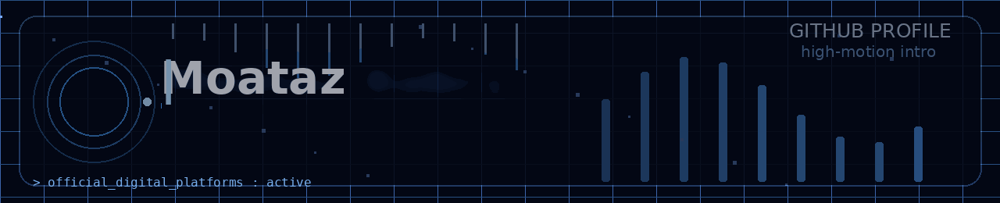
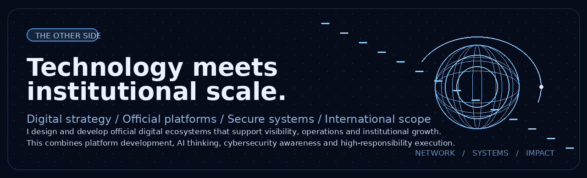

 
 

<h3>Designing intelligent platforms with institutional impact.</h3>

<strong>Abdelmouiz (Moataz) Kobry</strong> works across <strong>Computing, Artificial Intelligence, Cybersecurity and Platform Development</strong>, with a practical focus on building official digital systems that combine technical depth, operational clarity and long-term reliability.

His profile brings together <strong>official platform engineering, AI-oriented problem solving, secure digital thinking and institutional-scale execution</strong>. Rather than approaching technology as isolated code, he focuses on how systems support visibility, operations, communication and growth.

Among his most relevant hands-on work is the design and development of <strong>the official council website</strong> and <strong>the internal platform dedicated to council operations and management</strong>, covering digital structure, workflows, automation logic and the broader online ecosystem surrounding the institution.

&nbsp;
&nbsp;
&nbsp;

 

## `01 / Core Focus`

  

I work at the intersection of <strong>computing, platform architecture, intelligent systems and secure digital operations</strong>. My approach is centered on building systems that are not only functional, but also structured, scalable and mission-aware.

<table>
<tr>
<td valign="top" width="50%">
<strong><code>&gt; Platform development</code></strong>
<ul>
<li>Official websites and institutional digital platforms</li>
<li>Java, Python, JavaScript and PHP</li>
<li>APIs, databases and integration workflows</li>
<li>Automation logic, digital operations and system reliability</li>
</ul>
</td>
<td valign="top" width="50%">
<strong><code>&gt; AI &amp; cyber</code></strong>
<ul>
<li>Artificial intelligence and intelligent automation</li>
<li>Knowledge-based reasoning and data-oriented workflows</li>
<li>Cybersecurity awareness and security-minded development</li>
<li>Infrastructure thinking, troubleshooting and resilience</li>
</ul>
</td>
</tr>
</table>

### `> Official digital ecosystem building`

A core part of my work is the programming and development of <strong>official digital platforms</strong> that support real institutional needs. This includes public-facing websites, internal management systems, process structuring and the digital foundations that help organizations operate more effectively.

### `> Email infrastructure & deliverability`

Email is part of the engineering stack, not an afterthought. My technical interests and practical work also include <strong>DNS-based sender authentication and email deliverability</strong>, with a focus on:

`SPF` &nbsp; `DKIM` &nbsp; `DMARC` &nbsp; `SMTP` &nbsp; `DNS` &nbsp; `Authentication alignment` &nbsp; `Sender reputation`

Reliable delivery starts with correct configuration, authentication, monitoring and responsible sending practices.

## `02 / Beyond the Code`

  

Technology is only one layer of the work. I also operate in environments where <strong>clarity, coordination, institutional responsibility and strategic execution</strong> matter. This perspective influences how I design platforms: not only to function technically, but to serve broader objectives with structure and precision.

## `03 / GitHub Activity in 3D`

  
  Generated from GitHub's public contribution calendar and refreshed automatically by GitHub Actions.

## `04 / Let's Connect`

I welcome conversations around <strong>computing, artificial intelligence, cybersecurity, official platform development, email infrastructure and digital systems with institutional impact</strong>.

&nbsp;
&nbsp;

 
 

<strong>Build intelligent systems. Secure what matters. Develop with purpose.</strong>

Spain &nbsp; | &nbsp; Artificial Intelligence &nbsp; | &nbsp; Computing &nbsp; | &nbsp; Cybersecurity &nbsp; | &nbsp; Platform Development

