

  <a href="https://kobrymoataz.github.io/kobrymoataz/">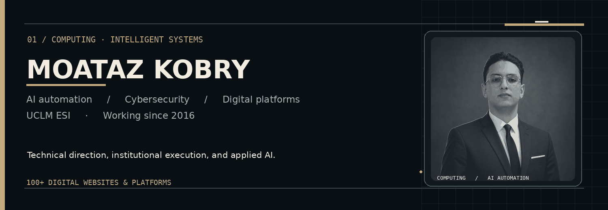</a>

  **Computing · AI Automation · Cybersecurity · Digital Platforms**

  [**Visit the portfolio ↗**](https://kobrymoataz.github.io/kobrymoataz/) &nbsp; · &nbsp; [**LinkedIn**](https://www.linkedin.com/in/kobrymoataz/) &nbsp; · &nbsp; [**Instagram**](https://www.instagram.com/kobrymoataz/) &nbsp; · &nbsp; [**Email**](mailto:president@mycdic.org) &nbsp; · &nbsp; [**Request CV ↗**](mailto:president@mycdic.org?subject=CV%20Request%20-%20Moataz%20Kobry&body=Hello%20Moataz%2C%0A%0AI%20would%20like%20to%20request%20your%20CV.%0A%0AMy%20name%3A%0AOrganization%3A%0APurpose%3A%0A%0AThank%20you.)

### Profile

I'm **Abdelmouiz (Moataz) Kobry**, focused on **Computing, Artificial Intelligence, automation and cybersecurity-aware development**. My academic direction is Computing at **UCLM, Escuela Superior de Informática (ESI)**. I started developing websites and digital systems in **2016**, with experience across **100+ websites and digital platforms**.

I lead digital platform work with colleagues from **MYCDIC** and **Trendad**, including work on MYCDIC's official website and its internal institutional management platform. My work connects software with operational requirements, communication, structured data and reliable delivery.

**Selected institutional work:** [Explore the public MYCDIC platform](https://www.mycdic.org/) · [Read the collaborative case studies](https://kobrymoataz.github.io/kobrymoataz/#systems)

### 01 / Systems and architecture

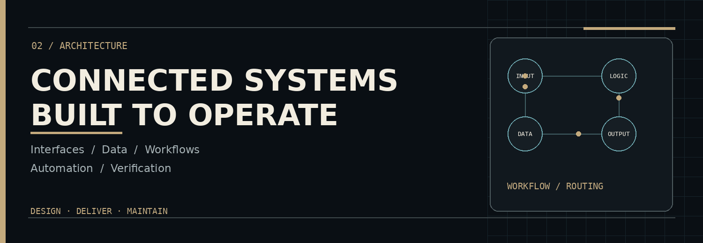

I build and improve websites, internal platforms, APIs, database-backed systems and operational workflows. I prefer systems that are maintainable, verifiable and understandable by the teams using them.

### 02 / Technologies

<table>
<tr><td align="center">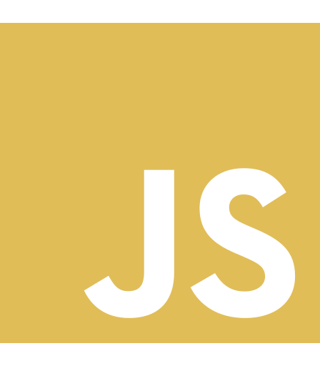 JavaScript</td><td align="center"> TypeScript</td><td align="center">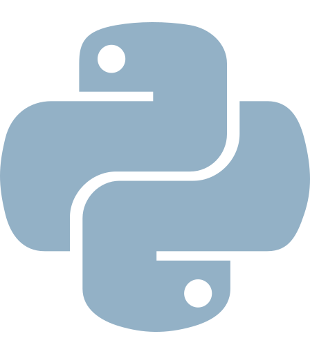 Python</td><td align="center">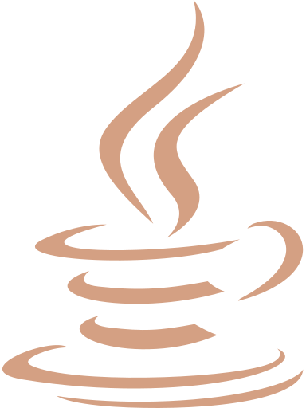 Java</td><td align="center">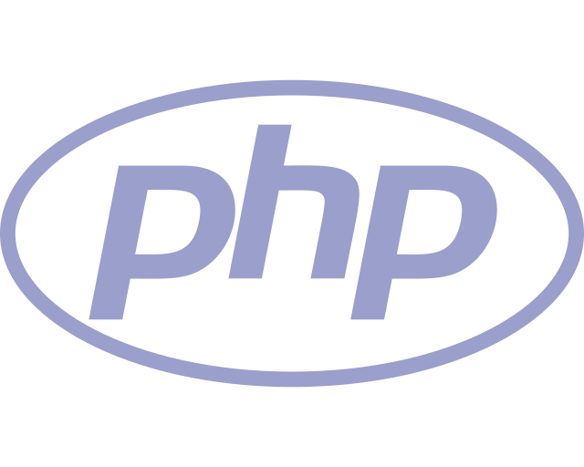 PHP</td><td align="center">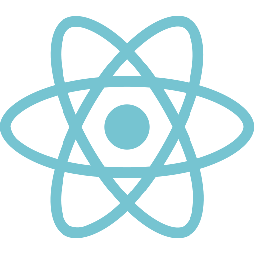 React</td></tr>
<tr><td align="center">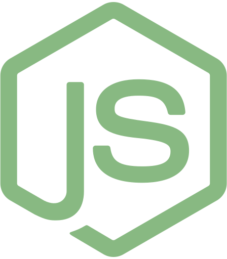 Node.js</td><td align="center"> React Native</td><td align="center">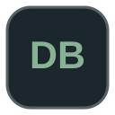 MongoDB</td><td align="center"> PostgreSQL</td><td align="center"> GitHub</td><td align="center">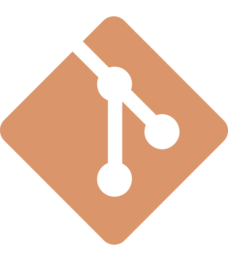 Git</td></tr>
</table>

**Automation and professional tooling:**

<table>
<tr><td align="center">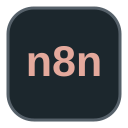 n8n</td><td align="center"> Google Workspace</td><td align="center"> Microsoft 365</td><td align="center">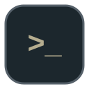 Prompt Engineering</td><td align="center">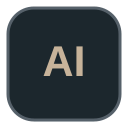 AI-assisted Development</td></tr>
</table>

My workflow includes **n8n**, **Google Workspace**, **Microsoft 365**, **prompt engineering** and **professional AI-assisted development (vibe coding)**. I use automation to accelerate delivery while maintaining deliberate implementation, review and testing.

**Backend &amp; data:** PHP · Firebase · PostgreSQL · MongoDB · SQL

 &nbsp;  &nbsp;  &nbsp; 

### 03 / Cybersecurity and email infrastructure

`SPF` &nbsp; `DKIM` &nbsp; `DMARC` &nbsp; `DNS` &nbsp; `SMTP` &nbsp; `Sender reputation` &nbsp; `Authentication alignment`

I work with email infrastructure, authentication and deliverability, alongside a security-aware approach to application development and organisational digital operations.

### 04 / Institutional and public-facing work

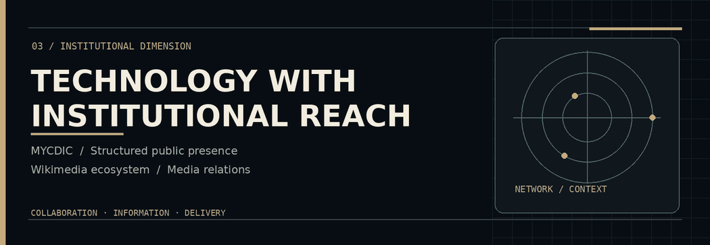

As **Founder & President of MYCDIC**, I work at the intersection of international cooperation, institutional coordination and technology. My wider experience includes **Wikipedia, Wikimedia, Wikidata, PR and media-facing digital communication**.

**Languages:** Arabic · English · French · Spanish

### 05 / Connect

**Email:** [president@mycdic.org](mailto:president@mycdic.org) &nbsp; | &nbsp; **LinkedIn:** [kobrymoataz](https://www.linkedin.com/in/kobrymoataz/) &nbsp; | &nbsp; **Instagram:** [kobrymoataz](https://www.instagram.com/kobrymoataz/)

**Institutional profile:** [MYCDIC President](https://www.mycdic.org/president/) &nbsp; | &nbsp; **Interactive portfolio:** [Visit site](https://kobrymoataz.github.io/kobrymoataz/)
