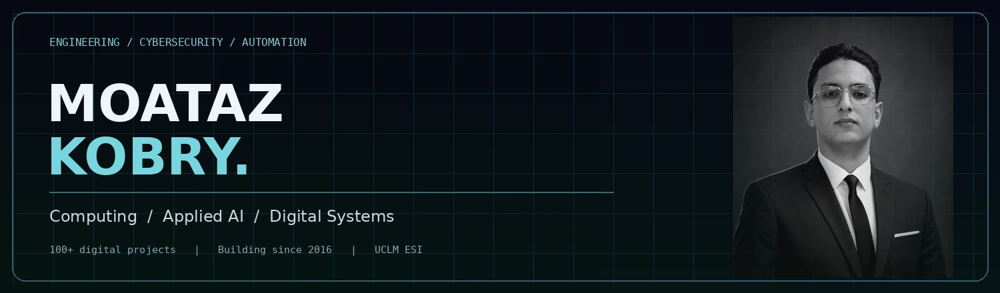

  

### Computing · AI Automation · Cybersecurity · Institutional Platforms

I build the digital infrastructure behind public-facing experiences: websites, management systems, integrations, automation and reliable communications. **I have developed 100+ digital websites and platforms since 2016**, alongside my work in **Computing at UCLM's Escuela Superior de Informática**.

My work includes the development of the **official [MYCDIC website](https://www.mycdic.org/)** and a **dedicated institutional management platform** used to organise council operations.

  <a href="https://kobrymoataz.github.io/kobrymoataz/"><b>Explore interactive portfolio ↗</b></a> &nbsp; · &nbsp;
  <a href="https://www.linkedin.com/in/kobrymoataz/">LinkedIn</a> &nbsp; · &nbsp;
  <a href="https://www.instagram.com/kobrymoataz/">Instagram</a> &nbsp; · &nbsp;
  <a href="mailto:president@mycdic.org?subject=CV%20Request%20-%20Moataz%20Kobry&body=Hello%20Mr%20Kobry%2C%0A%0AI%20would%20like%20to%20request%20your%20CV.%0A%0AName%3A%0AOrganisation%3A%0APurpose%3A">Request CV</a>

---

**Engineering:** JavaScript, Python, Java, PHP, React, React Native, Node.js, PostgreSQL, MongoDB, REST APIs, Git and GitHub Actions.

**AI & Google automation:** Applied AI, Google Apps Script, Sheets, Drive, Gmail, Forms, Docs, Workspace APIs, document generation and process automation.

**Cybersecurity & communications:** DNS, SPF, DKIM, DMARC, SMTP, sender authentication and deliverability.

**Beyond code:** Wikipedia, Wikimedia, Wikidata, PR, media relationships and institutional digital visibility. Founder and President of [MYCDIC](https://www.mycdic.org/president/).

The full portfolio is available at **[kobrymoataz.github.io/kobrymoataz](https://kobrymoataz.github.io/kobrymoataz/)**. It is a separate React experience with interactive system diagrams, case studies and a Three.js scene.
