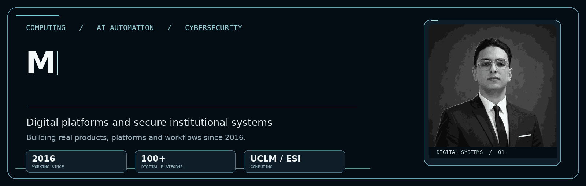
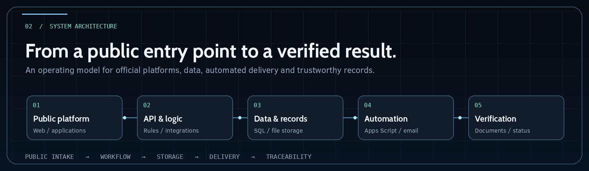
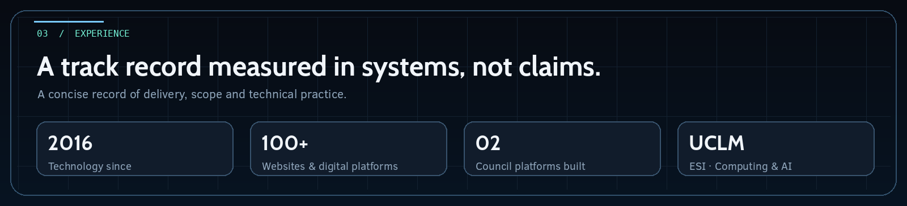
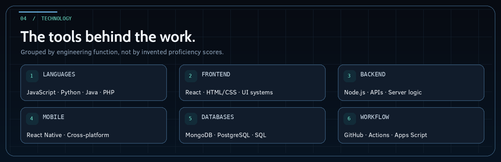
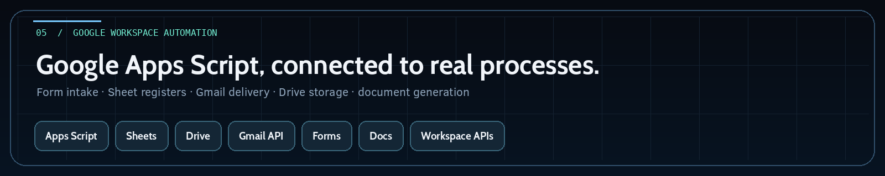
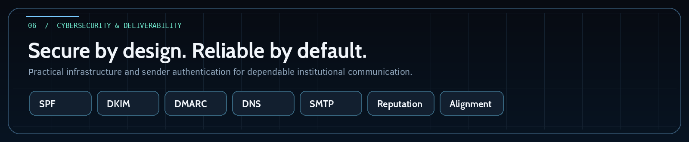
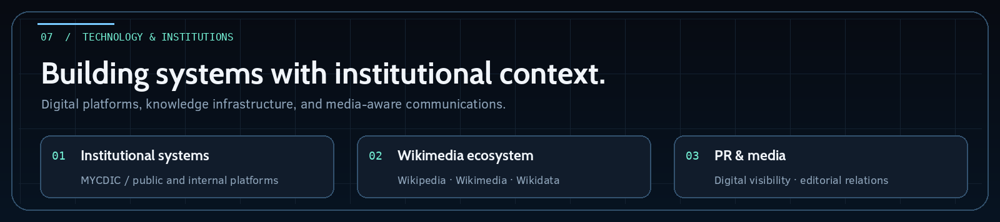
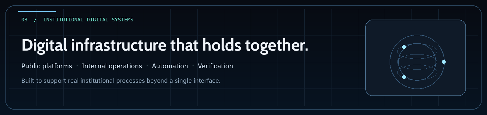

 

**Computing · AI Automation · Cybersecurity · Official Digital Platforms**

I design, develop and improve digital systems with an emphasis on reliable engineering, structured workflows and real institutional needs.

<a href="https://kobrymoataz.github.io/kobrymoataz/"><strong>Explore the interactive portfolio ↗</strong></a>

  

## 01 / About

I'm **Abdelmouiz (Moataz) Kobry**, working across Computing, Artificial Intelligence, automation and digital infrastructure. I study **Computing at UCLM's Escuela Superior de Informática (ESI Ciudad Real)** and have been building websites and digital systems since **2016**.

My work includes **more than 100 digital websites and platforms**, from public-facing experiences to systems that connect operations, records, automation and communications. I developed the official **MYCDIC website** and its **internal institutional management platform**, bringing the public and operational sides of the council into a coordinated digital environment.

## 02 / Systems architecture

I approach a platform as a complete operational chain, connecting interfaces, business rules, records, automation and verifiable output. The animated diagram illustrates that approach; it is a conceptual architecture, not a claim about the exact infrastructure of every project.

## 03 / Experience

## 04 / Technology stack

I work with **JavaScript, Python, Java, PHP, React, React Native and Node.js**, alongside **MongoDB, PostgreSQL, GitHub and GitHub Actions**.

### Google automation and integrations

Google Apps Script and Workspace tools support form intake, spreadsheet registers, document generation, file workflows and operational email delivery.

## 05 / Cybersecurity & deliverability

My work also covers email infrastructure and deliverability, particularly **SPF, DKIM, DMARC, DNS configuration, SMTP, sender reputation and authentication alignment**, alongside a security-aware approach to digital systems.

## 06 / Technology & institutions

Beyond software development, I work at the intersection of digital operations and institutional communication. This includes my role as **Founder & President of MYCDIC**, work involving **Wikipedia, Wikimedia and Wikidata**, and experience in PR and media-facing digital positioning.

## 07 / GitHub activity

*The contribution chart can refresh from GitHub's own contribution calendar through the included GitHub Actions workflow.*

---

**Build thoughtfully. Automate intelligently. Secure what matters.**

<a href="https://kobrymoataz.github.io/kobrymoataz/">3D Portfolio</a> · <a href="https://github.com/kobrymoataz?tab=repositories">Repositories</a> · <a href="mailto:president@mycdic.org">Email</a> · <a href="https://www.mycdic.org/president/">Institutional Profile</a>

