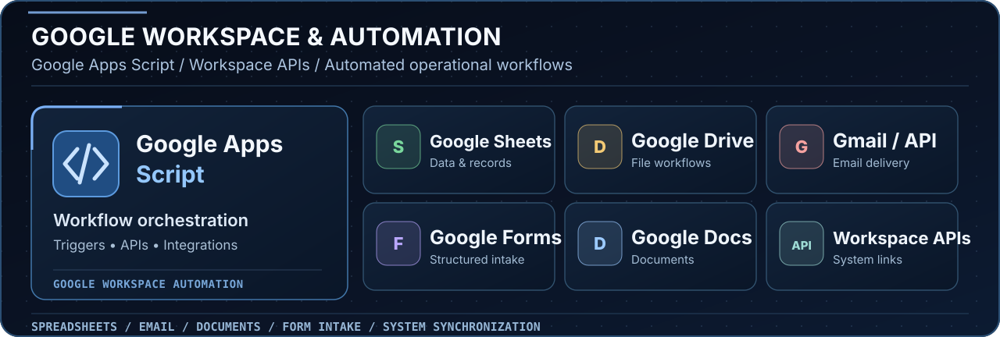

  

## `01 / Profile`

**Abdelmouiz (Moataz) Kobry** works across **Computing, AI Automation, Cybersecurity, and Official Platform Development**, with a practical orientation toward digital systems that are structured, secure, and operationally effective.

Since **2016**, his work has included the development of **100+ digital websites and platforms**, combining technical execution with a broader understanding of institutional visibility, digital operations, and long-term platform reliability.

He is academically rooted in **Computing at UCLM ESI**, while his practical work extends across **software development, automation, secure digital systems, public-facing platforms, and organizational digital infrastructure**.

&nbsp;
&nbsp;
&nbsp;
&nbsp;

## `02 / Technical & Digital Focus`

  

I work with **JavaScript, Python, Java and PHP**, as well as **React, React Native and Node.js** for web, mobile and service development. My data and development tools include **MongoDB, PostgreSQL, GitHub and GitHub Actions**. I also build automation workflows and integrations for digital platforms.

### `> Google Workspace & Apps Script`

  

I use **Google Apps Script** and Google Workspace services to connect **Sheets, Drive, Gmail, Forms and Docs** with operational systems. This includes form intake, record synchronization, email workflows, document generation and integrations through Google APIs.

### `> Selected platform work`

A central part of his work is the development of **official digital platforms** serving real organizational and institutional needs. This includes:

- the **official council website**
- the **internal platform dedicated to council operations and management**
- workflow structuring, automation logic, and digital process organization
- the wider digital ecosystem surrounding institutional communication and operations

### `> Knowledge visibility, media presence, and public positioning`

Beyond platform development, additional expertise includes:

- **Wikipedia, Wikimedia, and Wikidata**
- **digital public presence and online positioning**
- **PR support and media-facing communication work**
- institutional digital visibility and structured information presence

### `> Email infrastructure & deliverability`

Technical work also includes **email infrastructure and deliverability**, especially the reliability layers that support official and organizational communications.

`SPF` &nbsp; `DKIM` &nbsp; `DMARC` &nbsp; `SMTP` &nbsp; `DNS` &nbsp; `Authentication alignment` &nbsp; `Sender reputation`

Reliable delivery depends on proper configuration, correct authentication, monitoring, and disciplined sending practices.

## `03 / Institutional Digital Systems`

  

Technology here is approached not as isolated code, but as a tool for **structure, continuity, execution, and scale**. That perspective shapes how platforms are designed: to be dependable, coherent, and aligned with broader operational objectives.

## `04 / Track Record`

- **100+ digital websites and platforms** developed since **2016**
- experience spanning **official platforms, automation workflows, secure digital operations, and public-facing web systems**
- practical involvement in **institutional digital architecture, operational platforms, knowledge visibility, and media-oriented digital positioning**

## `05 / GitHub Activity in 3D`

  
  Generated from GitHub public activity and refreshed automatically with GitHub Actions.

## `06 / Contact`

I welcome conversations around **Computing, AI Automation, Cybersecurity, official digital platforms, Wikipedia and Wikidata work, email infrastructure, PR support, and digital systems with institutional value**.

&nbsp;
&nbsp;
&nbsp;

 
 

**Build dependable platforms. Automate intelligently. Secure what matters.**

UCLM ESI &nbsp; | &nbsp; Computing &nbsp; | &nbsp; AI Automation &nbsp; | &nbsp; Cybersecurity &nbsp; | &nbsp; Official Platform Development

