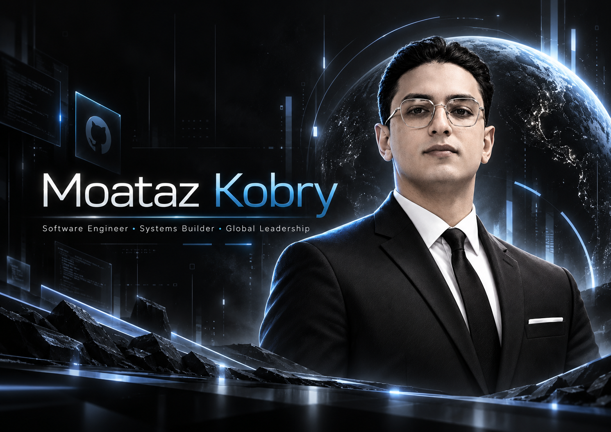
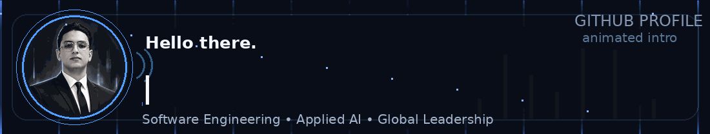
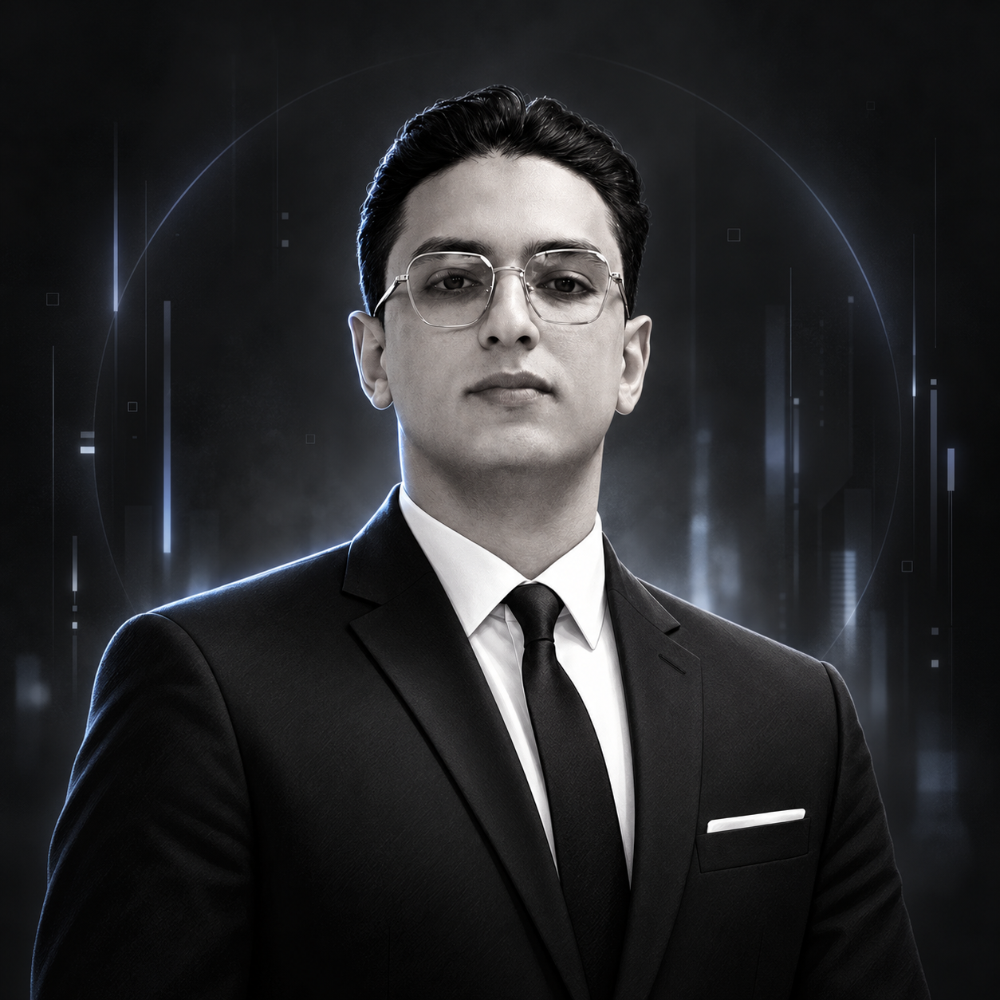
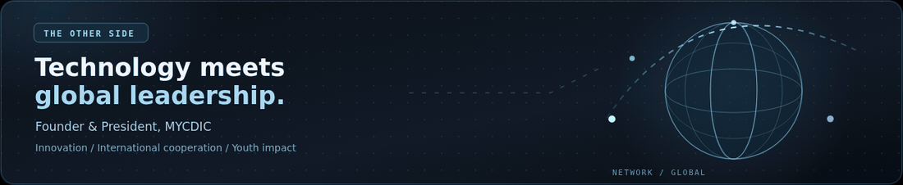

 
 

<table>
<tr>
<td width="190" valign="middle" align="center">
  
</td>
<td valign="middle">
<h3>Engineering ideas into systems that matter.</h3>

<strong>Abdelmouiz (Moataz) Kobry</strong> | Software Engineering &amp; Applied AI | Digital Systems

I design, build and improve software across <strong>back-end systems, web technologies, AI-driven automation and digital infrastructure</strong>. I study Computer Engineering at <strong>UCLM</strong> and apply an engineering mindset to multidisciplinary challenges.

Beyond code, I am the <strong>Founder &amp; President of <a href="https://www.mycdic.org/president/">MYCDIC</a></strong>, connecting technology with international cooperation, strategic thinking and youth leadership.

</td>
</tr>
</table>

&nbsp;
&nbsp;
&nbsp;

 

## `01 / Engineering Stack`

  

I work at the intersection of **software architecture, practical problem-solving and dependable infrastructure**. I care about how a system is designed, deployed, maintained and improved.

<table>
<tr>
<td valign="top" width="50%">
<strong><code>&gt; Software &amp; systems</code></strong>
<ul>
<li>Back-end engineering and web applications</li>
<li>Java, Python, JavaScript and PHP</li>
<li>APIs, databases and integration workflows</li>
<li>Distributed systems, event-driven integration and Kafka</li>
</ul>
</td>
<td valign="top" width="50%">
<strong><code>&gt; AI &amp; infrastructure</code></strong>
<ul>
<li>Applied AI and intelligent automation</li>
<li>Knowledge-based reasoning (CLIPS) and data workflows</li>
<li>Technical troubleshooting and reliability</li>
<li>Security-aware design and digital operations</li>
</ul>
</td>
</tr>
</table>

### `> Email infrastructure & deliverability`

Email is part of the engineering stack, not an afterthought. My technical interests and work also include **DNS-based sender authentication and email deliverability**, with a focus on:

`SPF` &nbsp; `DKIM` &nbsp; `DMARC` &nbsp; `SMTP` &nbsp; `DNS` &nbsp; `Authentication alignment` &nbsp; `Sender reputation`

Reliable delivery starts with correct configuration, authentication, monitoring and responsible sending practices.

## `02 / Beyond the Code`

  

Technology gives me the tools to build; leadership gives me a broader context for **why and for whom to build**. Through MYCDIC, I work across institutional collaboration, diplomacy, strategy and initiatives designed to create long-term value.

The same principles guide my engineering work: **clarity, ownership, collaboration and measurable impact**.

## `03 / GitHub Activity in 3D`

  
  Generated from GitHub's public contribution calendar and refreshed automatically by GitHub Actions.

## `04 / Let's Connect`

I welcome conversations around **software engineering, applied AI, email infrastructure, digital products and technology-enabled collaboration**.

&nbsp;
&nbsp;

 
 

**Build thoughtfully. Engineer reliably. Lead with purpose.**

Spain &nbsp; | &nbsp; International perspective &nbsp; | &nbsp; <a href="https://www.mycdic.org/president/">MYCDIC Presidency</a>

