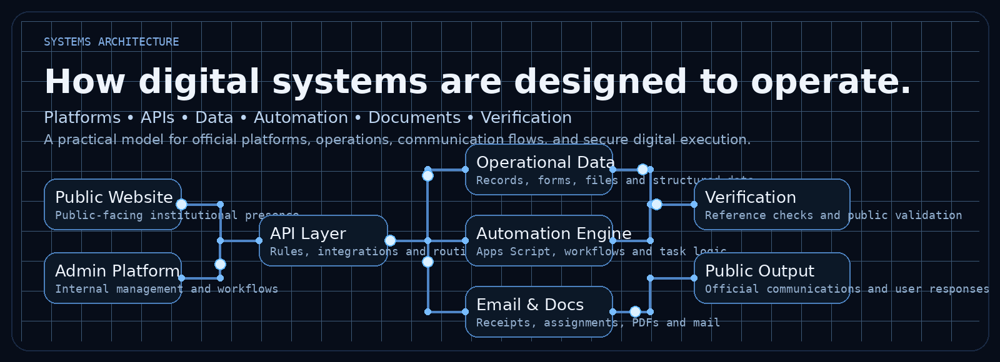
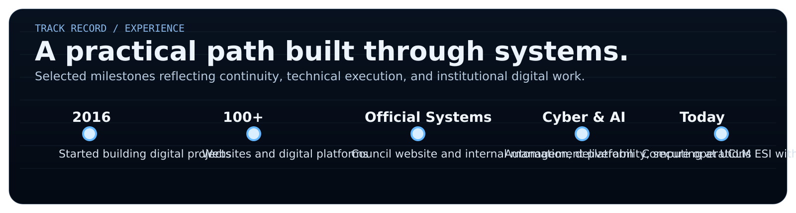
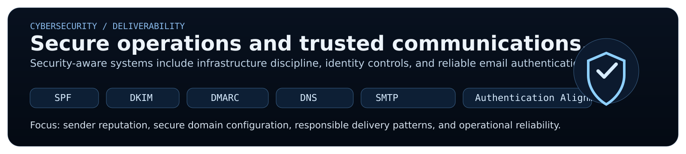
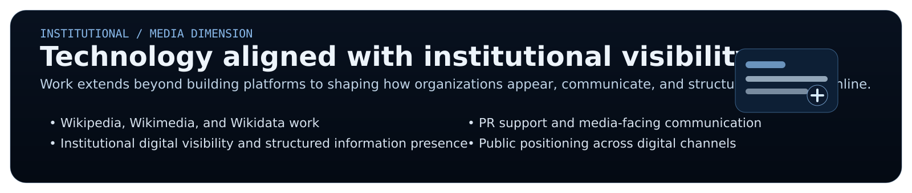

  

## `01 / Identity`

**Abdelmouiz (Moataz) Kobry** works across **Computing, AI Automation, Cybersecurity, and official platform development**, with a practical focus on building digital systems that are structured, secure, and operationally dependable.

Since **2016**, his work has included the development of **100+ digital websites and platforms**, combining technical execution with an institutional understanding of workflows, visibility, trusted communications, and long-term digital continuity.

His current academic foundation is in **Computing at UCLM ESI**, while his practical work extends across **web platforms, automation systems, Google-based workflows, secure infrastructure, email deliverability, and digital operations with institutional value**.

&nbsp;
&nbsp;
&nbsp;
&nbsp;
&nbsp;

## `02 / Systems Architecture`

  

Technology is approached here as an **operational system**, not as isolated code. A platform is treated as a chain of **public presence, internal workflows, data, automation logic, document generation, verification, and trusted output**.

This reflects a working method applied to:

- official public-facing platforms
- internal management systems
- workflow automation and execution logic
- document and email processes
- verification and structured public output

## `03 / Track Record`

  

**Selected signals of continuity and execution**

- active in digital development since **2016**
- developed **100+ digital websites and platforms**
- built the **official council website** and the **internal platform dedicated to council operations and management**
- works across **AI automation, cyber-aware systems, official communications, and operational digital infrastructure**

## `04 / Engineering Stack`

  

The engineering environment includes **JavaScript, Python, Java, PHP, React, React Native, Node.js, MongoDB, PostgreSQL, GitHub, and GitHub Actions**, with a strong interest in **automation, platform logic, and dependable implementation**.

### `> Google automation and workflow systems`

  

A significant part of the work also involves **Google Apps Script** and the wider **Google Workspace** ecosystem, especially for:

- form intake and submission handling
- record synchronization across services
- automated email and follow-up workflows
- document generation and structured files
- operational processes connected through Google APIs

## `05 / Cybersecurity & Deliverability`

  

Cybersecurity here is applied in a practical, systems-oriented way: **secure operations, authentication-aware infrastructure, and reliable communications**.

This includes work around:

`SPF` &nbsp; `DKIM` &nbsp; `DMARC` &nbsp; `DNS` &nbsp; `SMTP` &nbsp; `Authentication alignment` &nbsp; `Sender reputation`

Reliable delivery is treated as an engineering concern, not as an afterthought.

## `06 / Institutional Digital Systems`

  

The objective is not only to build interfaces, but to build **dependable digital ecosystems** aligned with continuity, execution, and institutional clarity.

This includes the ability to think in terms of:

- website architecture
- internal management systems
- digital process design
- operational structure and scale
- system continuity beyond a single interface

## `07 / Institutional and Media Dimension`

  

Beyond platform development, additional areas of experience include:

- **Wikipedia, Wikimedia, and Wikidata**
- **institutional digital visibility**
- **structured knowledge presence online**
- **PR support and media-facing communication**
- **public positioning through digital channels**

## `08 / Interactive 3D Site`

A separate **GitHub Pages** portfolio is included inside this package under the **`docs/`** folder.

It provides:

- a dedicated **Cyber & AI identity landing page**
- a **Three.js interactive background experience**
- direct presentation of systems architecture, track record, stack, cyber and institutional work
- a clean structure ready to publish via **GitHub Pages**

After enabling Pages from the **`docs/`** folder, the expected URL will be:

`https://kobrymoataz.github.io/kobrymoataz/`

## `09 / GitHub Activity`

  
  Generated from GitHub public activity and refreshable through GitHub Actions.

## `10 / Contact`

I welcome conversations around **Computing, AI Automation, Cybersecurity, platform engineering, workflow automation, email infrastructure, Wikipedia and Wikidata work, institutional digital systems, and media-facing digital execution**.

&nbsp;
&nbsp;
&nbsp;

 
 

**Build dependable systems. Automate intelligently. Secure what matters.**

UCLM ESI &nbsp; | &nbsp; Computing &nbsp; | &nbsp; AI Automation &nbsp; | &nbsp; Cybersecurity &nbsp; | &nbsp; Official Platform Development

