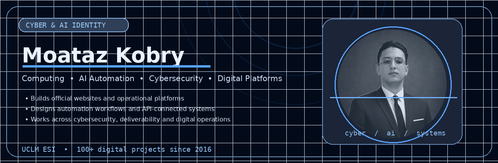
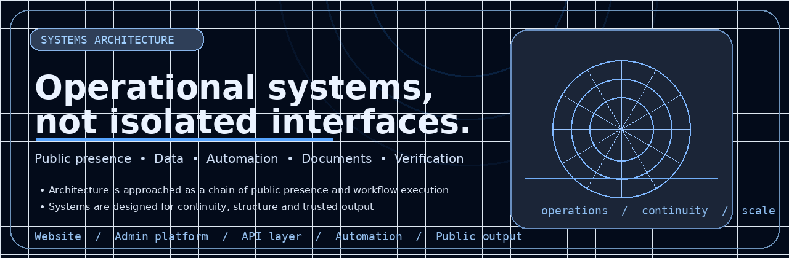
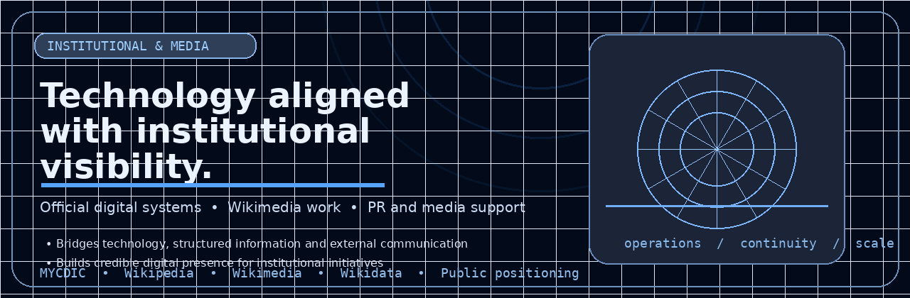

  
    

  <strong>Computing · AI Automation · Cybersecurity · Official Digital Platforms</strong>
   
  I design and improve structured digital systems for operations, automation, security and institutional execution.
    

  
  
  
  
  

## About

I am **Abdelmouiz (Moataz) Kobry**, a **Computing** student at **UCLM ESI** with a focus on **AI Automation**, cybersecurity and digital systems. I have been building websites and digital projects since **2016**, with experience across **100+ digital websites and platforms**.

My work includes the development of the **official MYCDIC website** and the **institutional management platform** used to support council operations, workflows and communications.

## Systems architecture

  

I approach systems as an operational chain: public interface, business logic, data handling, workflow automation, document generation, verification and final output.

## Technology stack

  

### Core technologies

- **Languages:** JavaScript, TypeScript, Python, Java, PHP
- **Frameworks & platforms:** React, Node.js, React Native
- **Databases:** MongoDB, PostgreSQL
- **Developer tools:** Git, GitHub, GitHub Actions, VS Code
- **Automation:** Google Apps Script, Google Sheets, Drive, Gmail flows, Docs and Forms integrations

### Google Workspace and automation

## Cybersecurity & deliverability

- SPF
- DKIM
- DMARC
- DNS configuration
- SMTP and email operations
- Sender reputation and authentication alignment

These areas support secure and reliable communications for institutional and operational platforms.

## Institutional and media dimension

  

Alongside engineering work, I also operate across institutional visibility and public-facing digital structure, including:

- **MYCDIC** digital and operational systems
- **Wikipedia, Wikimedia and Wikidata** work
- **PR and media-facing communication**
- **Official platform development** and structured public presence

## GitHub snapshot

  
  

## Contact

- **Email:** [president@mycdic.org](mailto:president@mycdic.org)
- **GitHub:** [github.com/kobrymoataz](https://github.com/kobrymoataz)
- **LinkedIn:** [linkedin.com/in/kobrymoataz](https://www.linkedin.com/in/kobrymoataz/)
- **Instagram:** [instagram.com/kobrymoataz](https://www.instagram.com/kobrymoataz/)

---

  <strong>Build thoughtfully. Automate intelligently. Secure what matters.</strong>

