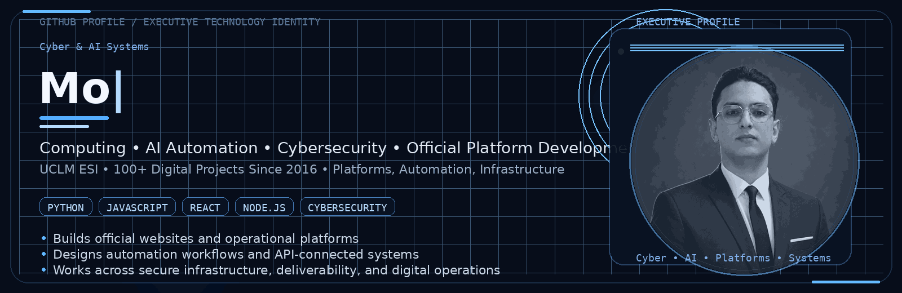
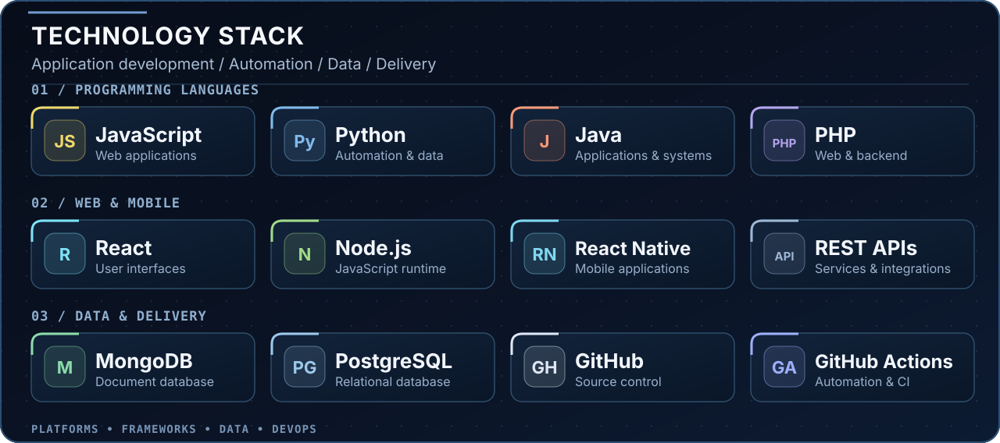
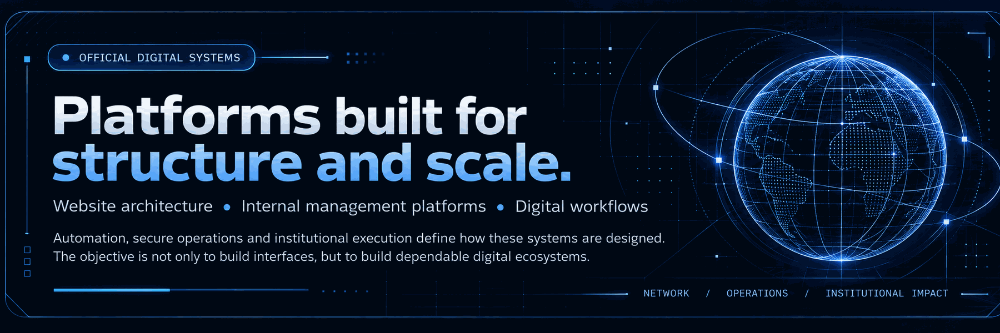
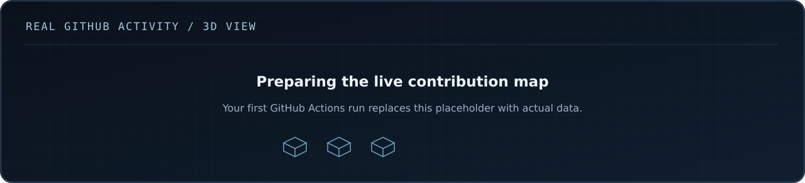

  

## `01 / Profile`

**Abdelmouiz (Moataz) Kobry** works across **Computing, AI Automation, Cybersecurity, and Official Platform Development**, with a focus on building digital systems that are structured, secure, and operationally useful.

His work combines **software development, automation thinking, security-minded design, and institutional execution**. The objective is practical: to create digital platforms that support visibility, workflows, communication, and reliable day-to-day operations.

With an academic base in **Computing at UCLM ESI**, his technical direction is centered on **platform development, automation, intelligent systems, and secure digital infrastructure**.

&nbsp;
&nbsp;
&nbsp;

## `02 / Technical Focus`

  

<table>
<tr>
<td valign="top" width="50%">
<strong><code>&gt; Core areas</code></strong>
<ul>
<li>Computing and software development</li>
<li>AI Automation and intelligent workflows</li>
<li>Cybersecurity-aware digital systems</li>
<li>Official websites and institutional platforms</li>
</ul>
</td>
<td valign="top" width="50%">
<strong><code>&gt; Practical stack</code></strong>
<ul>
<li>Java, Python, JavaScript, and PHP</li>
<li>Databases, APIs, and integration workflows</li>
<li>Automation logic and operational tooling</li>
<li>Secure digital operations and infrastructure thinking</li>
</ul>
</td>
</tr>
</table>

### `> Selected platform work`

A central part of his practical work is the development of **official digital platforms** that serve real institutional needs. This includes:

- the **official council website**
- the **internal platform dedicated to council operations and management**
- workflow structuring, automation logic, and digital process organization
- the broader online ecosystem surrounding institutional communication and operations

### `> Email infrastructure & deliverability`

Technical work also includes **email infrastructure and deliverability**, especially the configuration and reliability layers that support official communications.

`SPF` &nbsp; `DKIM` &nbsp; `DMARC` &nbsp; `SMTP` &nbsp; `DNS` &nbsp; `Authentication alignment` &nbsp; `Sender reputation`

Reliable delivery depends on correct configuration, proper authentication, monitoring, and disciplined sending practices.

## `03 / Institutional Digital Systems`

  

Technology here is not treated as isolated code. It is approached as a tool for **structure, continuity, execution, and scale**. That perspective shapes how platforms are designed: to be useful, coherent, dependable, and aligned with broader operational objectives.

## `04 / GitHub Activity in 3D`

  
  Generated from GitHub public activity and refreshed automatically with GitHub Actions.

## `05 / Contact`

I welcome conversations around **Computing, AI Automation, Cybersecurity, official digital platforms, email infrastructure, and operational digital systems**.

&nbsp;
&nbsp;

 
 

**Build dependable platforms. Automate intelligently. Secure what matters.**

UCLM ESI &nbsp; | &nbsp; Computing &nbsp; | &nbsp; AI Automation &nbsp; | &nbsp; Cybersecurity &nbsp; | &nbsp; Official Platform Development

